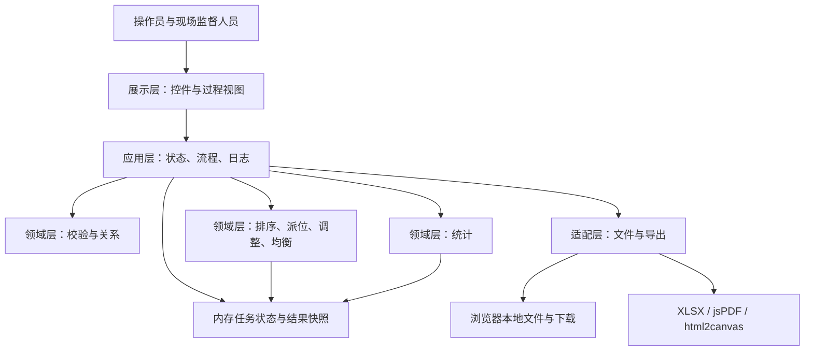
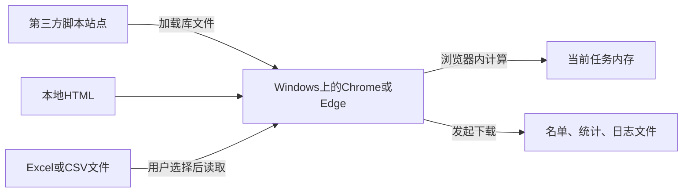
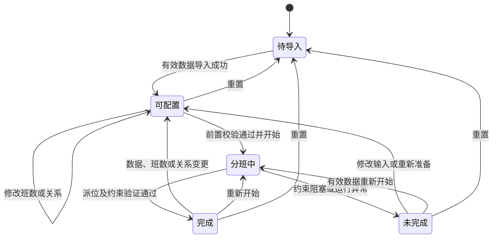
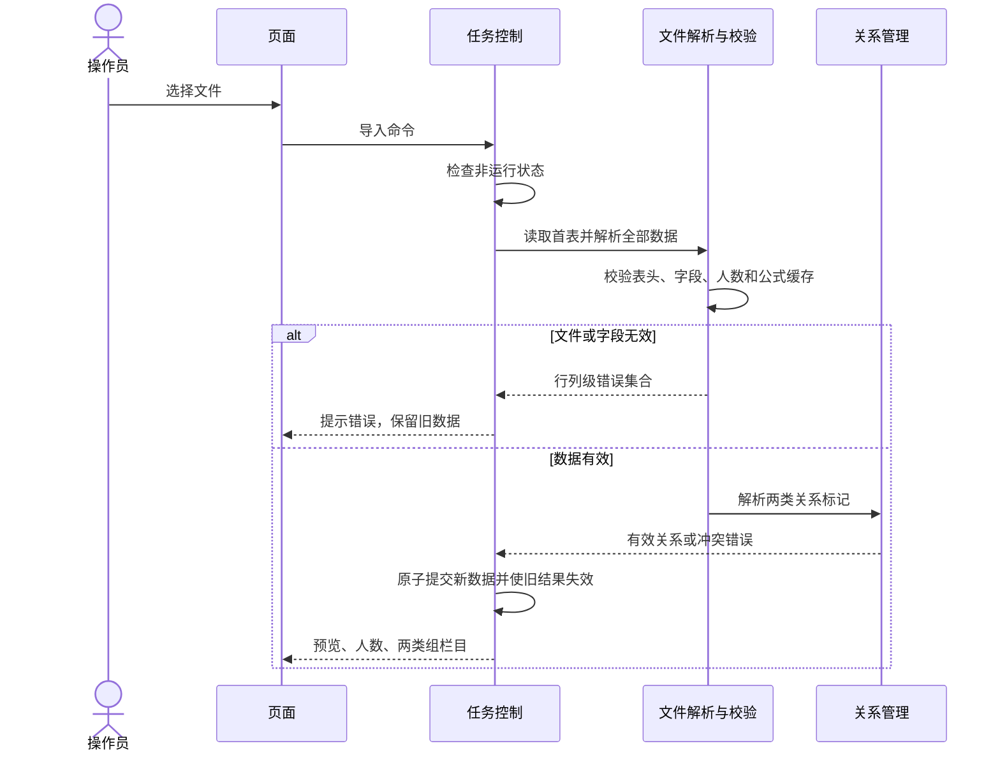
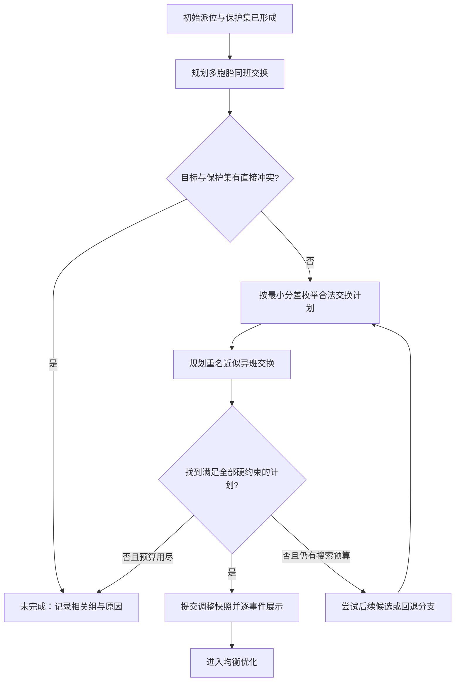
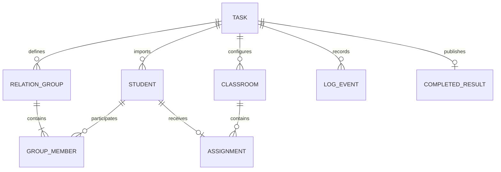

# 当涂县乌溪初级中学阳光分班系统软件设计文档

## 1. 架构设计

### 1.1 架构原则（ARCH-01）

采用浏览器单页应用架构。操作、计算、统计和导出在浏览器内完成，不设置业务服务端、数据库、登录服务或教务平台接口。学生数据只在一次页面会话中保存，导出文件承担结果交付和归档职责。

系统从逻辑上分为四层：

| 层 | 组成 | 职责 | 允许的依赖 |
|---|---|---|---|
| 展示层 | 页面控件、数据预览、关系栏目、班级卡片、统计、提示与日志视图 | 接收操作，展示当前状态和结果；不在渲染代码中重新定义分班规则 | 调用应用层，读取只读视图模型 |
| 应用层 | 任务状态、操作入口、流程编排、日志和结果版本管理 | 校验操作前置条件、串行执行任务、处理异常、协调计算与展示 | 调用领域层和适配层 |
| 领域层 | 数据校验、排序分组、随机派位、约束调整、均衡、统计 | 执行可单独测试的业务规则，维护不变量 | 使用结构化数据，不直接调用下载或操作DOM |
| 适配层 | 文件读取、XLSX、PDF、画布、计时、浏览器下载 | 将外部格式转换为内部结构，并将结果转换为文件 | 使用浏览器API和第三方库；不决定业务排序与约束 |



展示层不直接改动分班结果；所有变更经过应用层的状态检查。导出、统计和名单展示读取同一份完成结果，避免分别重算出不同版本。

### 1.2 部署与运行视图（ARCH-02）

最终网页的物理载体是一个 HTML 文件，内含样式、页面结构和 JavaScript 闭包。浏览器打开文件后建立DOM和内存状态，用户通过文件选择器读取学生数据，再通过浏览器下载机制取得结果。

| 运行组成 | 部署位置 | 作用与边界 |
|---|---|---|
| HTML、CSS、业务JavaScript | 用户计算机上的网页文件 | 业务入口和全部页面逻辑 |
| SheetJS XLSX 0.20.1 | 网页声明的外部脚本 | 读取Excel/CSV、建立与写出工作簿 |
| jsPDF 2.5.1 | 网页声明的外部脚本 | 创建A4 PDF、添加图像和保存文档 |
| html2canvas 1.4.1 | 网页声明的外部脚本 | 将包含中文的DOM内容转换为画布 |
| 本地输入文件 | 用户选定的文件 | 只经File API读取，不能任意扫描磁盘 |
| 任务数据和日志 | 当前页面内存 | 刷新或关闭页面后不保证保留 |
| 导出文件 | 浏览器下载目录或用户选择位置 | 由学校按业务需要保存、打印、交付 |

网页声明的依赖地址：

```text
https://cdn.sheetjs.com/xlsx-0.20.1/package/dist/xlsx.full.min.js
https://cdnjs.cloudflare.com/ajax/libs/jspdf/2.5.1/jspdf.umd.min.js
https://cdnjs.cloudflare.com/ajax/libs/html2canvas/1.4.1/html2canvas.min.js
```

这些地址是源文件中的依赖配置，不代表本次编写文档时对远端可用性的保证。首次运行需要相关脚本成功加载；不能将浏览器可能存在的缓存作为离线可用承诺。网络用于加载程序依赖，不用于上传学生数据。



### 1.3 运行状态与互斥（ARCH-03）



“分班中”包含排序、男生派位、女生派位、保护集冻结、关系调整、均衡和最终检查等阶段。用状态和运行标识共同控制操作；仅在运行锁为空时允许开始任务。运行期间禁止导入、班数和关系修改、重置以及结果导出。

异常退出必须在统一清理路径中释放运行锁。导出有独立的忙碌标志：导出期间不能重新导入、重置或再次发起相同导出，防止文件混合版本；普通查看不受影响。

## 2. 模块设计

### 2.1 模块边界与内部结构（MOD-01）

| 模块 | 职责与内部结构 | 输入/输出 | 源代码职责定位 |
|---|---|---|---|
| M01 页面与交互 | 控件状态、预览、关系视图、卡片、提示、统计可见性；展示与操作分离 | 视图模型→DOM；操作→命令 | `renderDataPreview`、`showMultiInfo`、`renderClassrooms`、按钮事件 |
| M02 任务与状态 | 班数、状态机、数据版本、运行锁、开始/完成/失败/重置生命周期 | 命令→新状态或错误 | `getClassCount`、`allocate`编排、班数与清除事件 |
| M03 文件导入 | 文件读取、首表提取、列解析、字段校验、批次提交 | 文件→学生及关系草稿 | 文件`change`事件、`parseNum`、`parseGender`、`calcTotal` |
| M04 关系管理 | 导入标记映射、建组、取消、编号、关系冲突检测 | 学生选择→关系集合 | `twinsGroups`、`similarGroups`及关系按钮事件 |
| M05 排序与分组 | 排序键K、同性别过滤、连续切片、保护名单排序 | 学生/C→有序组及保护集 | `compareDesc`、`groupConsecutive` |
| M06 随机派位 | 随机排列、组内互异目标、先男后女、事件输出 | 成绩组→初始分班 | `allocate`内部`processGroup` |
| M07 约束与均衡 | 合法候选、组级交换计划、可行性检查、D评价、终止条件 | 初始分班/关系→合规结果或失败 | `findBestSwapCandidate`、`swapValid`、`enforceConstraints`、`evaluatePair`、`balanceClasses`相关职责 |
| M08 统计与结果投影 | 名单展示排序、人数、Top80、学科均分、年级汇总 | 完成快照→统计和名单模型 | `updateCounts`、`updateStats` |
| M09 文件输出 | 模板、名单Excel、统计Excel、名单PDF、日志PDF、分页和下载 | 只读模型→文件下载请求 | 模板及导出按钮事件、`exportPDF` |
| M10 日志与时间 | 事件序号、任务/分班/导出时间、文本视图、复制及导出模型 | 业务事件→日志条目 | `log`、`logEntries`、`delay`、日期处理 |
| M11 校验与错误 | 字段校验、状态校验、不变量、业务冲突、错误分类 | 草稿/命令/结果→校验结果 | 跨导入、分班、导出入口的统一校验职责 |

### 2.2 关键模块详细设计

**M02：任务控制。** 数据导入、关系修改和班数改变均递增`dataVersion`，撤销当前版本的完成标志。开始时取得`runId`和输入快照，处理过程中只修改工作副本；成功后一次性发布`CompletedResult`。相同页面的重复点击不得创建第二条执行链。

**M04：关系管理。** 内部关系使用稳定组标识和学生标识，不以屏幕显示序号作为引用。建组时检查成员去重、数量≥2、同类组不重叠和跨类同班/异班矛盾。取消动作按“与所选学生存在交集”筛选两类关系；显示序号由剩余组的位置计算，原始导入标记仅用于追溯，不继续作为有效组号展示。

**M07：约束与均衡。** 维护学生到班级的反向索引、冻结保护集和各班人数计数。关系调整使用工作副本规划交换，校验后提交；一组关系需要多次交换时，在内部形成完整计划后再播放事件，不能把半完成状态当成结果。均衡只在可行结果上运行，每次交换必须保持硬约束且使全局D下降超过阈值。

**M09：统一输出。** Excel、PDF和页面名单先读取同一个`RosterView`，统一班级顺序、性别顺序、K排序和班内序号。适配器只负责文件格式和排版，不另设排序、分数计算或班级判断规则。

## 3. 关键流程设计

### 3.1 FL-01 导入与关系建立



用户取消文件选择时直接结束流程。空文件、只有表头或全部为空行时按无有效学生处理。公式仅读取文件保存的值：性别无有效缓存值时报错；总分无缓存值时从三科数值计算；三科自身无有效数值仍属输入错误。

人工建组流程：勾选→检查至少两人→检查同类重叠和跨类矛盾→写入关系→数据版本加一→旧结果失效→重绘关系和预览→记录日志。任一检查失败均不改动关系。取消流程按两个类别分别删除与选择集合相交的整组，再统一重编号。

### 3.2 FL-02 排序、随机派位与保护集冻结

1. 检查数据有效、C合法、关系没有显式冲突且没有运行中的任务。
2. 创建输入快照和工作班级数组，锁定修改控件，记录本次任务开始及班数、人数。
3. 男生和女生分别按K排序，按C连续切分；男生组执行完后再执行女生组。
4. 对每个成绩组随机打乱学生顺序；生成C个班号的随机排列，取前`组人数`个互异班号作为目标。完整组覆盖全部班级，尾组不固定偏向较小班号。
5. 每名学生加入目标班后生成派位事件，更新姓名、性别、总分和目标班提示，再按节奏展示。完整组900ms，尾组850ms。
6. 完成所有初始派位后检查学生守恒和初始组内班级互异。
7. 各班不分性别按K排序取前min(10,n)名作为保护集，同时记录每个多胞胎组的最高排名成员所在班，作为该组固定目标。

随机排列使用Fisher–Yates过程，随机源由浏览器提供。业务不承诺密码学级随机、固定随机种子复现或不同运行结果必然不同。日志保留实际派位顺序和去向，供过程核对。

### 3.3 FL-03 多胞胎与重名近似调整



**多胞胎处理。** 按显示组号顺序处理；成员按K排序。最高排名成员的初始班级固定为目标，不移动保护学生。对每个不在目标班的成员，枚举目标班可交换学生，排除保护集成员、会拆散已固定关系的候选及与组成员冲突的候选。按总分差绝对值升序、K顺序、原始顺序排列候选。选择能形成完整可行计划的第一个候选，而不是提交一个使后续关系无法完成的局部交换。

**重名近似处理。** 找到同组中仍同班的成员，保留K排名靠前者，优先规划排名靠后者迁移。目标班必须不含本组其他成员；按班级人数升序、班号升序枚举。目标班内以最小分差顺序枚举合法交换对象。连续处理直到组成员分别位于不同班级。

**多约束处理。** 规划过程允许暂时存在尚未处理的关系，但不能将它们误判为此次交换新造成的破坏。完整计划必须联合检查所有关系和人数约束。采用确定顺序的候选搜索和有限回退；不要求遍历全部可能排列。搜索耗尽或达到时间上限仍无完整可行计划时，报告本次搜索未完成，不发布成功结果。

每次交换在数据上同时完成两个学生的换班；展示阶段对双方使用独立事件或在同一提示中完整显示姓名、性别、总分和方向。两个相关班级同时可见，其余班级暂时隐藏，关系调整事件每次至少800ms。

### 3.4 FL-04 均衡优化与最终验证

定义班级集合`C1…Cc`，非空班级的Top80总分均分为`Ai`：

`D = max(Ai) - min(Ai)`，非空班少于两个时D=0。

```text
输入：满足全部硬约束的分班工作副本
记录 D_before
对最多 500 轮：
    improved = false
    按班号顺序枚举两班，按固定学生顺序枚举非保护学生对
    对候选交换执行试算
    如果任一硬约束不成立：拒绝
    如果全局 D_old - D_new > 0.001：提交交换并记录事件
    否则：撤销试算
    分段让出主线程，累计有效计算用时
    如果本轮无改善或计算预算耗尽：停止
最终执行完整不变量校验
若通过：发布完成结果、统计和固定分班日期
否则：保留诊断并标记未完成
```

计算时间与动画等待分开累计，整个任务的计算预算为60s。优化开始前已获得合规结果；因此优化预算耗尽可以保留最后一个合规版本并完成，日志写明终止原因。均衡不以找到全局最优解为成功条件，也不牺牲硬约束追求均分下降。

### 3.5 FL-05 统计、导出及重置

**统计与导出。** 完成状态检查→读取同一版本结果快照→生成名单/统计视图→验证导出依赖→分页或构建工作簿→发起浏览器下载→记录“已发起下载”。导出异常只影响此次输出，不能清空结果；清理临时DOM、Canvas及忙碌标志后允许重试。

**重置。** 非运行、非导出状态→说明清空范围→清空学生、关系、班级成员、结果、统计和本任务日志→保留班级数→重建空班卡和计数→清空文件选择值→新日志写入重置事件。清空文件选择值保证后续再次选择同一文件仍可触发导入。

## 4. 接口设计

### 4.1 接口约定（IF-00）

内部接口以JavaScript对象或Promise传递数据，不使用HTTP。以下名称为逻辑接口契约，用于界定模块责任，不强制改变现有函数命名。

```typescript
type AppError = {
  code: string;
  message: string;                 // 可向操作员展示的中文说明
  stage: string;
  row?: number; column?: string;  // 文件定位，从1开始计数
  studentIds?: string[];
  groupIds?: string[];
  retryable: boolean;
};
type Result<T> = { ok: true; value: T } | { ok: false; errors: AppError[] };
```

数组位置不作为跨模块的永久学生标识。公开到页面的数据不包含库异常堆栈。接口失败时返回错误集合，不返回半有效结果；浏览器API的抛错和Promise拒绝由适配层统一转换。

### 4.2 内部接口（IF-01—IF-09）

| 接口编号 | 逻辑签名 | 输入/输出格式 | 错误及调用限制 |
|---|---|---|---|
| IF-01 | `parseImport(file, schema): Promise<Result<ImportDraft>>` | File→学生数组、关系草稿、原始行定位 | 非运行时调用；E_FILE/E_SCHEMA/E_VALUE/E_LIMIT；不修改当前任务 |
| IF-02 | `commitImport(draft, expectedVersion): Result<TaskView>` | 完整草稿、版本→可配置视图 | 草稿全部通过校验；E_STALE/E_BUSY；整体替换 |
| IF-03 | `changeRelation(type, action, memberIds): Result<Relations>` | 类型twins/similar；create/cancel；学生标识列表 | E_SELECTION/E_GROUP/E_CONFLICT；禁止运行中调用 |
| IF-04 | `rankAndGroup(students, classCount): RankedGroups` | 规范化Student[]、整数C→男女有序组 | 前置数据已校验；纯计算，不改输入顺序 |
| IF-05 | `runAllocation(snapshot, onEvent): Promise<Result<CompletedResult>>` | 冻结输入快照；事件回调→完成结果或错误 | 一个runId仅一条执行链；E_BUSY/E_CONSTRAINT/E_TIMEOUT/E_RUNTIME |
| IF-06 | `validateAssignment(assignment, rules): ValidationReport` | 班级成员、保护/关系/人数规则→违规列表 | 无副作用；结果包含规则编号、关联学生与班级 |
| IF-07 | `buildStats(result): StatisticsView` | 完成快照→C行班级＋1行年级 | E_STATE/E_STALE；空均分为null，由视图显示“—” |
| IF-08 | `exportArtifact(kind, snapshot): Promise<Result<DownloadStarted>>` | template/rosterXlsx/statsXlsx/rosterPdf/logPdf | 名单及统计要求完成状态；E_DEPENDENCY/E_RENDER/E_DOWNLOAD；导出锁 |
| IF-09 | `appendEvent(event): LogEntry` | 类型、时间、相关标识、前后班级、说明→有序日志 | 同步编号；禁止从DOM倒推日志；失败操作也可记录 |

进度事件示例：

```json
{
  "type": "ASSIGN",
  "runId": "run-1",
  "sequence": 18,
  "studentId": "student-17",
  "sourceClassId": null,
  "targetClassId": 3,
  "phase": "maleAllocation"
}
```

交换事件需包含两名学生、各自交换前后班级和业务原因。界面通过学生标识读取姓名和成绩，日志与界面不得各自推算事件方向。

### 4.3 外部与第三方接口（IF-10）

| 外部接口 | 调用与格式 | 限制与失败处理 |
|---|---|---|
| 文件选择器 | `<input type="file" accept=".xlsx,.xls,.csv">`；`File.arrayBuffer()` | accept仅作为选择提示；内容仍需校验；用户取消无错误 |
| XLSX读取 | `XLSX.read(ArrayBuffer)`，首表`sheet_to_json(...,{header:1})` | 固定列顺序；仅用公式已保存结果，不执行公式；异常转E_FILE |
| XLSX写出 | `book_new`、`aoa_to_sheet`、`book_append_sheet`、`writeFile` | 文本单元格必须为文本类型；格式、居中和打印属性须以输出文件检查，不能只看内存属性 |
| PDF | `new jsPDF('p','mm','a4')`、`addPage`、`addImage`、`save` | 按A4可打印区域设置尺寸；图片等比放置；错误转E_RENDER或E_DOWNLOAD |
| 画布 | `html2canvas(element,{scale:2,...})` | 页面内自有内容；字体加载完成后渲染；分页后逐页生成，完成即释放临时节点 |
| 日期与计时 | Date提供墙钟；单调计时器记录处理耗时；定时器控制动画 | 日期依赖本机设置；时间序号保证顺序；后台节流不视为算法计算耗时 |
| 浏览器下载 | 文件名与内容Blob或库保存入口 | 只确认发起下载；不能保证用户最终接受保存或磁盘写入完成 |
| 剪贴板/文本选择 | 日志提供可选择文本；可用时调用浏览器剪贴板 | 剪贴板权限失败不影响日志查看，保留手动选择复制路径 |

没有对外REST API、数据库连接或第三方学生数据传输接口。第三方库仅在浏览器中接收数据结构。

## 5. 数据设计

### 5.1 实体模型（DATA-01）



这是一份内存逻辑模型，不要求部署关系数据库。

### 5.2 关键实体与字段

| 实体 | 关键字段 | 格式与约束 |
|---|---|---|
| Task | taskId、dataVersion、runId、state、classCount、startedAt、completedAt、allocationDate | C为2—25整数；版本单调递增；allocationDate仅成功完成时确定 |
| Student | studentId、registrationNo、name、gender、identityNo、sourceSchool、chinese、math、english、total、mathExtra、sourceRow | 报名号唯一且为文本；gender仅男/女；成绩有限非负；total=三科和；sourceRow保留文件定位 |
| RelationGroup | groupId、type、sourceMarker、memberIds、displayOrder | 成员去重且至少2人；同类不重叠；原始标记与显示序号分离 |
| Classroom | classId、name、memberIds | classId=1…C；name=`classId+班`；memberIds表示成员，不兼作最终输出排序 |
| Assignment | studentId、classId、phase、eventSequence | 最终每名学生唯一一条有效对应关系；事件序号记录当前去向的来源 |
| ProtectionSet | studentIds、originalClassByStudent | 初始派位后形成、运行期间不可变；不足10人的班保护全部学生 |
| CompletedResult | taskId、dataVersion、assignment、protectionSet、relations、allocationDate、statistics、optimizationSummary | 发布前验证全部硬约束；含优化前后D及终止原因；对导出只读 |
| LogEvent | sequence、timestamp、type、stage、studentIds、from/toClass、message、outcome | 序号严格递增；时间含本地日期和时区偏移；说明只含业务所需数据 |

### 5.3 存储结构与派生索引（DATA-02）

- `students: Student[]`保存当前学生主数据，`studentById: Map`提供定位。
- `twinsGroups`和`similarGroups`保存两类关系；成员引用内部标识。
- `classrooms`保存班级成员；`classByStudent: Map`维护反向定位。
- `protectedStudents: Set`与`protectedClassByStudent: Map`支持常数时间保护检查。
- `completedResult`保存成功快照；`workingAssignment`用于当前计算；失败时不发布工作副本。
- `logEntries`为顺序事件数组；界面文本和PDF从同一数组产生。
- 人数、男女数、分数汇总和Top80缓存仅为派生数据；以学生主数据和成员关系为准，交换后仅更新受影响班级，再进行最终全量核验。

不使用localStorage、IndexedDB或Cookie存储学生信息。导出文件含个人信息，后续保管由学校承担。重置移除对旧任务数据的业务引用，但不承诺操作系统级物理内存擦除。

### 5.4 数据一致性与数值口径（DATA-03）

1. **导入一致性**：先解析和完整校验，再一次性提交；任何错误均保留原有效数据。
2. **标识一致性**：报名号是业务唯一标识，内部studentId用于引用；姓名允许相同；身份证允许空。
3. **数值一致性**：输入成绩最多两位小数，内部可采用整数百分之一分保存并求和；均分使用未舍入值比较，展示时才格式化两位小数。
4. **关系一致性**：有效关系为唯一权威集合；预览、左右栏目、校验及日志使用同一组数据，不能继续展示已经取消的有效标注。
5. **分班一致性**：`全部班级学生并集=输入学生集合`，交集为空；反向索引与班级成员双向一致。
6. **版本一致性**：修改输入后旧完成版本失效；统计、显示和导出必须引用同一`dataVersion`。
7. **交换一致性**：两名学生的班级、反向索引、计数和事件一起提交；失败全部回滚。
8. **统计一致性**：Top80取`ceil(0.8n)`，按K选人；年级独立计算；空均分使用null，显示“—”，不参与D极差计算。

## 6. 界面与交互设计

### 6.1 页面区域（UI-01）

| 顺序 | 区域及控件 | 交互设计 |
|---|---|---|
| 1 | 程序名称 | 居中显示，与导出标题使用同一配置值 |
| 2 | 班级数量、下载模板、导入学生数据、清除所有数据 | 一排主操作，可随窗口换行；运行中锁定可能改变任务的控件 |
| 3 | 男生、女生、总人数 | 显示当前有效导入人数，导入及重置后立即更新 |
| 4 | 学生明细表 | 12列加选择列；固定表头、滚动查看、全选；错误定位到行列 |
| 5 | 设为多胞胎、设为重名近似、取消选中组 | 使用勾选结果；提示数量不足、重复或冲突；成功后同步关系显示 |
| 6 | 左侧多胞胎、右侧重名近似 | 显示连续组号、报名号、姓名、性别；无组时显示“无” |
| 7 | 当前动作提示、开始阳光分班 | 准备、排序、派位、调整、完成或失败阶段清晰可辨 |
| 8 | 班级卡片 | 准备/完成时全部按班号显示；运行时聚焦相关班；学生横向排列并换行 |
| 9 | 显示/隐藏统计、Excel/PDF/日志导出 | 统计默认折叠，使成绩数据按需查看；导出按钮按状态启用 |
| 10 | 统计与日志展开内容 | 统计含年级末行；日志可滚动、选择复制；长表不挤压关键操作 |

### 6.2 不同角色的交互（UI-02）

操作员使用全部操作区域；监督人员主要查看当前动作、班级卡片、统计与日志；班主任主要使用导出文档。角色差异通过信息使用场景体现，不增加账户、授权菜单或角色切换功能。

动画只突出正在处理的学生，但相关班级内已经派入的学生保留展示。男女分别使用颜色和图标，并在当前动作文字中显示性别。换班时使用“姓名（性别、总分）：原班→目标班”表达，避免只给箭头而无法判断方向。

页面允许纵向滚动，不要求1500人同时占据一个屏幕。所有按钮提供中文文本或可访问名称；键盘焦点可见，状态不能仅用颜色表达。

### 6.3 打印交互（UI-03）

Excel和PDF由统一名单视图生成。各班从新页开始；默认A4纵向，当页面内容按完整列宽和最小8pt字号可放下一班时采用一班一页，否则自动续页。续页重复标题、班级、表头和页码，不拆开一个学生的数据行。签名栏居中，分班日期固定为完成日期，导出日期单独进入日志。

预先定义列宽、文本换行、页边距和行高，先测量再分页。PDF图像保持纵横比例，不能拉伸整张长表到一页造成不可读。Excel设置打印区域、每班分页、重复表头和一页宽；输出是否达到该效果以实际文件打印预览为准。

## 7. 非功能设计

### 7.1 性能与时间设计（NFR-01）

| 需求目标 | 设计措施 | 度量口径 |
|---|---|---|
| 1500人导入≤10s | 一次读取首表；校验与规范化线性处理；批量更新预览DOM，避免逐单元格触发布局 | 固定环境，文件读取开始到可操作预览；5次取最大 |
| 统计≤2s | 人数及总和一次遍历；每班与年级排序选Top80；使用同一统计模型 | 完成快照到统计可见 |
| 累计计算≤60s | 各阶段维护计算预算；搜索分段；达到边界及时退出 | 不含动画定时等待与系统暂停 |
| 交互P95≤200ms，连续阻塞≤1s | 计算批次约每50ms检查是否让出事件循环；绘制与计算分离；避免无界同步嵌套遍历 | 100次以上交互样本及主线程长任务记录 |
| Excel≤10s、PDF≤60s | 复用已生成视图，按页输出，逐页释放画布，不生成整份日志巨型画布 | 输出动作到发起下载，5次取最大 |
| 动画节奏可读 | 派位900/850ms、关系800ms、均衡200ms；定时器等待不阻塞主线程 | 活动标签页中事件实际可见时长 |

N≤1500、C≤25时，排序主要为`O(N log N)`，分组和派位为`O(N)`。一轮两班学生对候选枚举可达`O(N²)`，加上关系和统计计算后代价更高，因此不能依靠“最多500轮”单独保证响应时间。采用缓存、受影响班级增量计算、分段执行和60s预算共同约束耗时。

500轮是最大搜索轮数，预算到达可提前终止；性能目标不意味着保证在60s内求出任意复杂约束的可行解。动画总耗时按照需求文档的F/R/A/B公式计算，1500人初始展示可能超过22分钟。

### 7.2 可靠性设计（NFR-02）

导入采用草稿提交；分班使用运行快照和工作副本；交换采用原子提交；完成前统一执行不变量检查；导出从只读完成结果取数。所有异步入口采用统一捕获和最终清理，避免文件读取、动画或画布异常造成永久忙碌。

验收必须通过10次完整任务循环，错误、旧数据残留、学生遗漏和重复均为0。关闭网页不提供会话恢复；此边界在任务操作说明中明确，以文件导出完成业务归档。

### 7.3 安全与个人信息保护（NFR-03）

学生字段使用文本节点或转义后的安全文本渲染，不将文件内容直接拼接为可执行HTML。Excel输出中报名号、姓名、身份证、生源等固定为文本单元格，避免被解释为公式。日志仅记录分班必要的学生标识、姓名、班级与操作，不额外复制身份证等敏感字段。

网络请求中不得包含学生资料、工作簿内容或日志。原始文件仅经用户选择后读取；页面不写持久化学生数据库。第三方依赖版本固定，升级前执行解析、输出和安全回归。

### 7.4 可用性、兼容性与维护性（NFR-04）

支持Windows 10/11下项目验收固定版本的64位Chrome/Edge，至少1366×768视口，验证100%、125%、150%缩放。界面使用语义明确的按钮、可识别键盘焦点、文字和图标冗余表示状态。长表及班级卡片通过滚动、换行适应空间。

程序名称、字段列表、排序函数、统计函数、错误字典和动画参数使用统一逻辑入口；PDF与Excel共享名单模型。扩展科目或修改班数上限需要同步字段定义、排序、统计、布局和测试，不允许只改界面标签。当前范围不增加插件市场、在线配置中心等无直接业务必要的功能。

## 8. 异常与故障处理设计

### 8.1 错误分类和恢复（ERR-01）

| 错误码 | 故障模式 | 处理路径 | 恢复方式 |
|---|---|---|---|
| E_DEPENDENCY | XLSX、PDF或画布对象不可用 | 阻止受影响功能，说明缺失依赖；已加载数据保留 | 恢复依赖后重新操作；不要自动清除任务 |
| E_FILE | 文件损坏、加密而无法读取或实际格式错误 | 导入整体失败，说明文件不可读取 | 用户选择可读取文件 |
| E_SCHEMA | 表头缺失、列顺序不符 | 定位表头问题，不提交数据 | 按模板修正后导入 |
| E_VALUE | 姓名/性别/分数/公式结果非法 | 汇总行列和原因，保持旧数据 | 修改源文件后重新导入 |
| E_LIMIT | 无有效学生或超过1500人、班数越界 | 在计算前拒绝 | 修正范围 |
| E_SELECTION | 建组不足两人、取消无选择 | 提示最少选择数量或取消语义 | 重新勾选 |
| E_GROUP | 同类重叠、重复组、单成员标记 | 拒绝本次关系写入 | 修正关系或原始标记 |
| E_CONFLICT | 同班异班矛盾、重名组人数超过C | 开始前拒绝并列出相关组 | 修改标注或有效班数 |
| E_CONSTRAINT | 保护集/关系/人数无法通过本次调整计划 | 标记未完成，保留诊断和日志，不开放正式结果导出 | 修正配置或重新执行 |
| E_TIMEOUT | 计算预算耗尽 | 无可行结果则未完成；已有可行结果则停止优化并说明原因 | 查看原因、调整输入或重新执行 |
| E_BUSY | 重复开始或运行中修改 | 禁用控件并在入口再检查；不创建新任务 | 等待本次任务结束 |
| E_STATE / E_STALE | 尚无完成结果或结果版本不匹配 | 拒绝导出，不返回旧结果 | 重新分班 |
| E_RENDER | 页面测量、字体或画布生成失败 | 清理临时节点和画布，保留结果 | 重新导出或检查运行环境 |
| E_DOWNLOAD | 保存调用失败 | 记录失败而非已保存；解除导出锁 | 再次发起下载 |
| E_RUNTIME | 未预期运行异常 | 终止本次运行，释放锁，展示阶段和简明原因 | 在保留有效输入的基础上重新执行 |

### 8.2 恢复与一致性规则（ERR-02）

- 可重试的文件读取和导出错误不得自动触发新一轮随机分班。
- 运算失败后不得悄然删除输入或关系；工作副本可供说明失败阶段，但必须明显标为未完成。
- 未发生输入版本变更且已有上一份完成快照时，失败任务不能损坏该快照；若需访问，应明确为上一任务结果，不将其显示为本次成功结果。
- 因修改输入导致的旧结果失效不能通过失败回滚重新变为当前有效结果。
- 运行中刷新或关闭页面会丢失内存；不承诺跨页面恢复。计时器延迟后恢复执行时需检查runId，旧运行回调不得写入新任务。
- 日志自身渲染失败不能改变分班数据；内部结构化事件保留，可再次展开或导出。

## 9. 设计决策与权衡

| 决策编号 | 选定方案 | 备选方案 | 选择理由及未选理由 |
|---|---|---|---|
| ADR-01 | 浏览器单页、本地处理 | 服务端分班、数据库存储 | 1500人、单操作员任务无需部署服务端；本地方式降低维护和个人信息传输范围。服务器方案适于多人协同，但超出本任务范围。 |
| ADR-02 | 使用工作簿保存的公式结果 | 在网页中实现Excel公式引擎 | 只需读取性别和总分结果；完整公式引擎涉及函数兼容和重算依赖，成本与任务不匹配。无缓存按明确错误/回退规则处理。 |
| ADR-03 | 同性别排序后连续分组，再组内随机派位 | 全年级无分层完全随机；按成绩固定蛇形分班 | 连续分组使同成绩层学生分散且保留随机过程。完全随机不稳定保障性别和成绩层分布；固定蛇形缺少要求的组内随机性。 |
| ADR-04 | 成绩组互异仅约束初始派位；后续执行关系与保护约束 | 要求每个初始成绩组在最终结果仍严格分散 | 若多胞胎落在同一成绩组，最终同班与最终分散可能直接矛盾；分阶段定义保留原流程业务意义。 |
| ADR-05 | 前十名在初始派位后冻结 | 每次交换后重新选前十；仅按性别分别保护 | 冻结集合可核验且不随优化漂移；逐次重选会允许原受保护学生失去保护；分别按性别不符合“各班前十名”口径。 |
| ADR-06 | 交换保持班级人数，约束失败明确结束 | 单向移入后再补人数；自动放宽保护或同班异班要求 | 交换不改变每班总人数，可继承初始人数差≤2；单向移入增加规模修复难度；自动放宽会产生不能验收的结果。 |
| ADR-07 | 有界候选搜索和单调改善均衡 | 穷举所有分班、承诺全局最优；只跑一次随机且不调整 | 穷举组合数量巨大，不能满足浏览器时限；不调整不能覆盖关系要求。有界搜索可终止，失败语义明确，不作全局最优承诺。 |
| ADR-08 | A4优先每班一页，超容量自动续页 | 不论人数强制缩为一页；交给用户手动排版 | 最多1500人、最少2班可产生很长名单；强行压缩会损害可读性，手工排版违背直接打印目标。按最小8pt和完整行分页保证可实现。 |
| ADR-09 | 中文DOM按页栅格化后写入PDF | 直接用PDF默认字体绘制；生成整份长画布再裁切 | DOM沿用浏览器中文字体显示；默认字体可能缺少需要的字形；超长画布增加内存和截断风险。代价是PDF文本搜索/复制不作为承诺，另提供Excel和日志文本。 |
| ADR-10 | 内存任务与显式导出 | 自动写浏览器持久化存储 | 无账号和清理策略的持久化增加个人信息滞留；当前任务由学校通过文件归档，刷新恢复不在范围。 |
| ADR-11 | 统一排序、统计和导出视图模型 | 页面、Excel、PDF各自计算 | 统一模型便于追溯、回归和跨格式比对；重复计算容易导致日期、顺序、前80%成员不一致。 |

## 10. 需求追溯矩阵

下表覆盖需求分析文档全部43项编号。设计元素包括架构ARCH、模块M、流程FL、接口IF、数据DATA、界面UI、非功能NFR及错误ERR；测试编号对应需求文档的最小验收集合。

| 需求编号 | 需求摘要 | 设计元素 | 验证用例 |
|---|---|---|---|
| REQ-001 | 三格式与首表导入 | M03、FL-01、IF-01/10 | AT-02 |
| REQ-002 | 输入完整校验及容量 | M03/M11、DATA-03、ERR-01 | AT-03 |
| REQ-003 | 公式缓存结果 | FL-01、IF-10、ADR-02 | AT-02/03 |
| REQ-004 | 学生守恒与保真 | M11、DATA-03、IF-06 | AT-02/03/06 |
| REQ-005 | 页面及导出名称 | M01/M09、UI-01 | AT-01 |
| REQ-006 | 班数设置及结果失效 | M02、ARCH-03、DATA-03 | AT-01/12 |
| REQ-007 | 模板下载 | M09、IF-08/10 | AT-01/02 |
| REQ-008 | 完整预览及计数 | M01/M08、UI-01 | AT-02 |
| REQ-009 | 关系识别与栏目 | M04、FL-01、UI-01 | AT-04 |
| REQ-010 | 人工建组及冲突 | M04/M11、IF-03、ERR-01 | AT-04 |
| REQ-011 | 整组取消与重编号 | M04、FL-01、DATA-03 | AT-04 |
| REQ-012 | 排序与连续分组 | M05、IF-04、FL-02 | AT-05 |
| REQ-013 | 先男后女、随机互异 | M06、FL-02、ADR-03 | AT-05/06 |
| REQ-014 | 前十名冻结保护 | M05/M07、DATA-01/02、ADR-05 | AT-07 |
| REQ-015 | 多胞胎同班调整 | M07、FL-03、IF-06 | AT-07 |
| REQ-016 | 重名近似异班调整 | M07、FL-03、IF-06 | AT-07 |
| REQ-017 | 总人数与性别人数差 | M07/M11、FL-04、DATA-03 | AT-06/07 |
| REQ-018 | Top80均分优化 | M07/M08、FL-04、NFR-01 | AT-08 |
| REQ-019 | 过程聚焦与信息突出 | M01/M06/M07、UI-02 | AT-09 |
| REQ-020 | 卡片学生完整可见 | M01、UI-01/02 | AT-09 |
| REQ-021 | 人数统计及年级汇总 | M08、IF-07、DATA-03 | AT-10 |
| REQ-022 | 均分及Top80口径 | M08、DATA-03、UI-01 | AT-09/10 |
| REQ-023 | 合并统计Excel | M09、IF-08、ADR-11 | AT-10/11 |
| REQ-024 | 名单Excel与打印 | M09、IF-10、UI-03 | AT-11 |
| REQ-025 | 名单PDF与签名日期 | M09/M10、UI-03、ADR-08/09 | AT-11 |
| REQ-026 | 完整日志与查看复制导出 | M10、IF-09/10、DATA-01 | AT-08/11/13/15 |
| REQ-027 | 重置与重新使用 | M02、FL-05、ERR-02 | AT-15 |
| REQ-028 | 状态与运行互斥 | M02、ARCH-03、IF-05 | AT-12 |
| REQ-029 | 旧结果失效与版本 | M02、IF-02/07/08、DATA-03 | AT-12 |
| REQ-030 | 动画等待时间 | M10、FL-02/03/04、NFR-01 | AT-09 |
| REQ-031 | 日期与事件时序 | M10、DATA-01、IF-09/10 | AT-13 |
| REQ-032 | 输入异常定位与原子失败 | M03/M11、FL-01、ERR-01 | AT-03/14 |
| REQ-033 | 冲突与不可行说明 | M07/M11、FL-03、ERR-01 | AT-04/07 |
| REQ-034 | 运行异常及超时 | M02/M07、FL-04、ERR-01/02 | AT-07/08/14 |
| REQ-035 | 导出故障恢复 | M09、FL-05、IF-08、ERR-01 | AT-14 |
| REQ-036 | 最大规模及导入统计性能 | M03/M08、NFR-01 | AT-03/17 |
| REQ-037 | 计算预算和终止 | M07/M10、FL-04、NFR-01 | AT-08/17 |
| REQ-038 | 响应性及导出性能 | M01/M09、NFR-01、UI-03 | AT-09/11/17 |
| REQ-039 | 连续任务可靠性 | ARCH-03、DATA-03、NFR-02 | AT-12/15 |
| REQ-040 | 个人信息与注入防护 | IF-10、NFR-03、DATA-02 | AT-16 |
| REQ-041 | 依赖识别与环境边界 | ARCH-02、IF-10、ERR-01 | AT-01/14 |
| REQ-042 | 键盘、缩放和冗余提示 | M01、UI-02、NFR-04 | AT-01/09 |
| REQ-043 | 规则统一及维护 | MOD-01、NFR-04、ADR-11 | AT-17 |

## 11. 测试与验证考虑

### 11.1 设计可测试性（TEST-01）

业务算法接受数据对象并返回结果，不依赖DOM；排序、分组、统计、候选校验、保护集和最终不变量可以单独测试。时钟和动画等待由统一入口提供，测试可使用可控时间；随机源在测试中可注入确定序列，以覆盖尾组、交换和失败分支，实际运行仍使用浏览器随机源。

确定序列只用于验证业务规则，不改变验收中对随机性的定义。随机用例按“同组不同班、完整组覆盖全部班、学生集合守恒”断言，避免使用“必须产生某一份随机名单”作为验收标准。

### 11.2 分层验证

| 层次 | 验证内容 | 必须检查的证据 |
|---|---|---|
| 单元验证 | K排序、ceil取整、空集合、数值保真、关系交集、候选合法性 | 输入/期望/实际值；全同分和边界样本 |
| 算法性质验证 | 随机组互异、学生守恒、保护不变、关系成立、人数差阈值、D单调不增 | 每次事件后的不变量报告、最终分班映射 |
| 集成验证 | 导入→建组→分班→统计→导出→重置 | 相同版本、相同报名号集合、字段及统计对照 |
| 界面验证 | 控件互斥、进度信息、双班交换、长表、键盘焦点和缩放 | 录屏或截图、操作序列 |
| 文件验证 | Excel单元格类型与打印设置、PDF完整中文、续页和日志 | 实际输出文件、打印预览、抽查与全量行数统计 |
| 故障注入 | 缺依赖、读取异常、公式无缓存、搜索超时、画布失败、下载异常 | 错误码、用户提示、锁释放、数据保留情况 |
| 性能验证 | N/C矩阵、前台计时、长任务、导出速度 | 机器配置、浏览器版本、五次原始耗时及最大值 |
| 安全验证 | 输入HTML/脚本/公式样式字符串；监测请求及持久存储 | 原文显示与导出、无执行、无学生数据请求、无持久化记录 |

### 11.3 关键边界样例

1. **导入**：0、1、1500、1501人；空行、重名不同报名号、重复报名号、前导零、完整18位身份证、非法数值及公式错误。
2. **排序**：仅数学附加分不同、仅语文不同、仅数学不同、仅英语不同、所有字段相同；确认原始顺序稳定。
3. **分组**：C=2/25；N<C；单性别人数为C−1、C、C+1；无男生或无女生。
4. **关系**：两人/三人多胞胎；三名重名近似同班；不同关系交叉；同类重叠；重名组大于C；保护名单与关系冲突；无可交换候选。
5. **统计**：0、1、5、6、11人班；前80%边界同分；年级前80%与各班并集不同；均分恰在舍入边界附近。
6. **运行**：开始按钮连续触发，动画等待期尝试修改，导出中重置，旧回调晚到，失败后重试，10次完整任务循环。
7. **时间**：跨午夜、系统时间回拨、后台再回前台；事件序号不乱，分班日期不随导出改变。
8. **输出**：每班少量及数百名学生、长姓名和生源、超长日志；检查A4续页、最小字号、表头重复和没有丢失学生行。

### 11.4 验证结论规则

只有最终不变量全部通过，任务才可发布为“分班完成”。只有实际文件打开、打印预览和内容核验通过，才可判定输出需求合格。性能应附原始测量结果，不能仅依据算法复杂度推断达标。
